<div align="center">

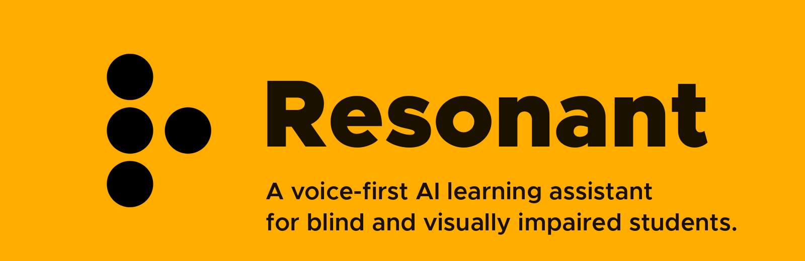

<br>

*A voice-first AI learning assistant built for blind and visually impaired students. Upload any material and learn entirely by listening and asking questions.*


[Screens](#screens) &nbsp;·&nbsp; [How it works](#how-it-fits-together) &nbsp;·&nbsp; [Run it](#how-to-open-and-run-it) &nbsp;·&nbsp; [Live voice](#live-mode-talk-to-your-pc) &nbsp;·&nbsp; [Chat / voice AI](#chat--voice-ai-setup) &nbsp;·&nbsp; [Gestures](#the-gesture-grammar) &nbsp;·&nbsp; [Themes](#themes) &nbsp;·&nbsp; [Interaction model](#the-interaction-model-in-code) &nbsp;·&nbsp; [TalkBack](#talkback) &nbsp;·&nbsp; [Limitations](#known-prototype-limitations) &nbsp;·&nbsp; [License](#license) &nbsp;·&nbsp; [Credits](#credits)

<br>

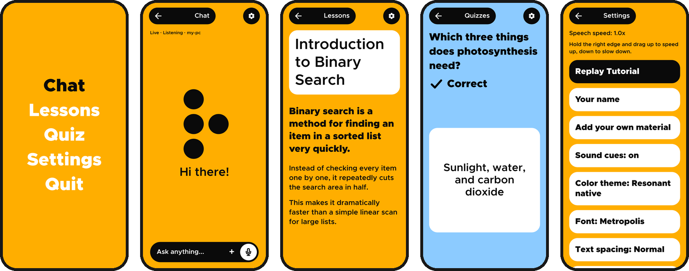

<sub>Screens are renders of the app's own layout, fonts and colors, not device captures. See <a href="#a-note-on-the-screenshots">a note on the screenshots</a>.</sub>

</div>

<div align="center">
<table>
<tr>
<td align="center"><br><sub>Idle</sub></td>
<td align="center"><br><sub>Listening</sub></td>
<td align="center"><br><sub>Thinking</sub></td>
<td align="center"><br><sub>Speaking</sub></td>
</tr>
</table>
<sub>The braille "R" is Resonant's face. It shows what the app is doing, and every state also has a sound and a vibration.</sub>
</div>

<div align="center">
  
</div>

## Why Resonant

Most apps assume you can see the screen: find the button, tap the button. For someone who can't, that is the whole problem.

Resonant takes the screen out of the equation. There is nothing to find. Gestures are read by zone, not by position, they mean the same thing on every screen, and every action answers back in speech, a vibration pattern, and a tone.

- **Learn by listening.** Lessons are read aloud one unit at a time. Pause, repeat, slow down, speed up.
- **Ask instead of searching.** Talk to an AI by voice and hear the answer while it is still being written.
- **Bring your own material.** Add a text file, Markdown, a PDF or a photo of a page or graph. Resonant reads it like a lesson, and Chat answers from it.
- **Quizzes without looking.** Every answer option has its own counted buzz and tone.
- **No perfect connection needed.** Speech recognition can run offline on the phone, and Chat falls back to reading the lesson when the AI server is down.
- **Made for every kind of low vision, too.** Twelve color themes, three typefaces, adjustable text spacing and size, and a Reduce motion switch.

<div align="center">
  
</div>

## Screens

Everything here is driven by gestures; the screen is for sighted helpers and for people with some vision. Focus is always drawn as the inverted item, so it is never only spoken.

<div align="center">
<table>
<tr>
<td align="center">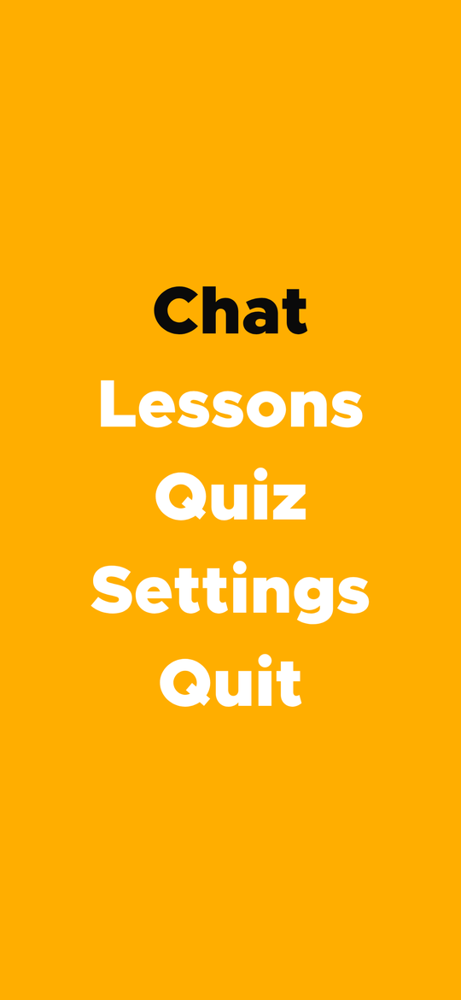<br><b>Home</b><br><sub>Swipe to move, tap to open</sub></td>
<td align="center">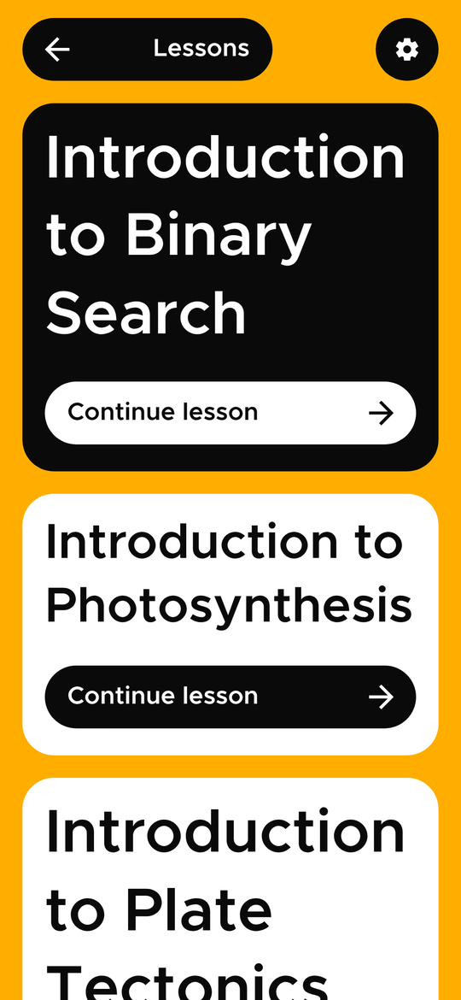<br><b>Lessons</b><br><sub>Built in, then your own material</sub></td>
<td align="center">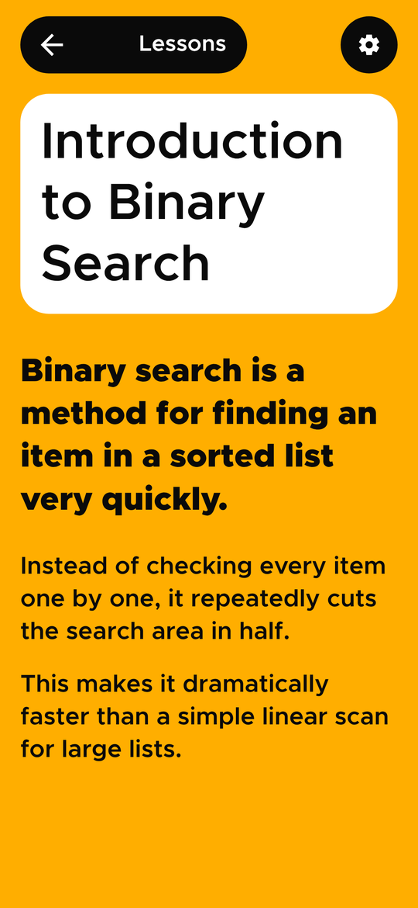<br><b>Lesson</b><br><sub>One unit at a time, pinch to resize</sub></td>
<td align="center">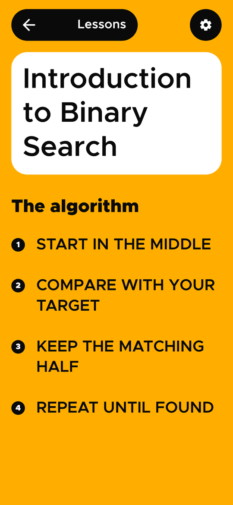<br><b>Steps</b><br><sub>Procedures get numbered steps</sub></td>
</tr>
<tr>
<td align="center">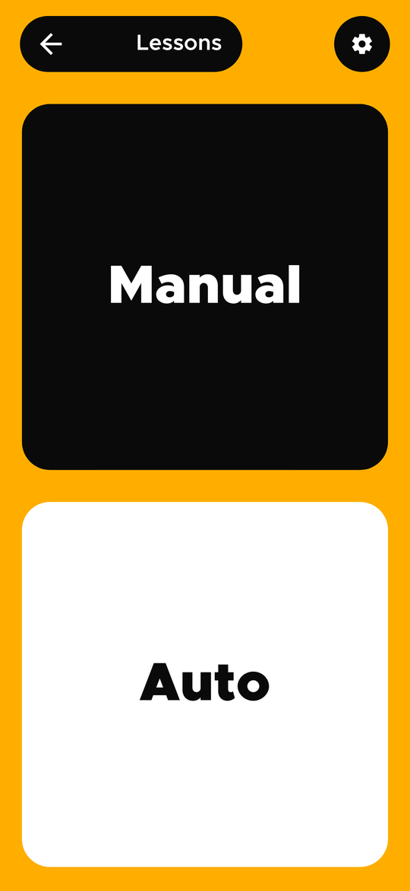<br><b>Manual or Auto</b><br><sub>You advance, or it does</sub></td>
<td align="center">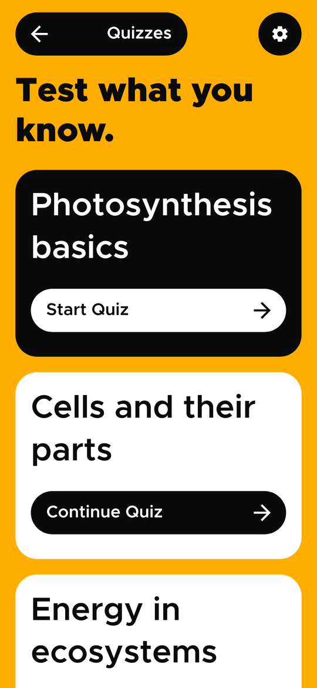<br><b>Quizzes</b><br><sub>Start, continue or review</sub></td>
<td align="center">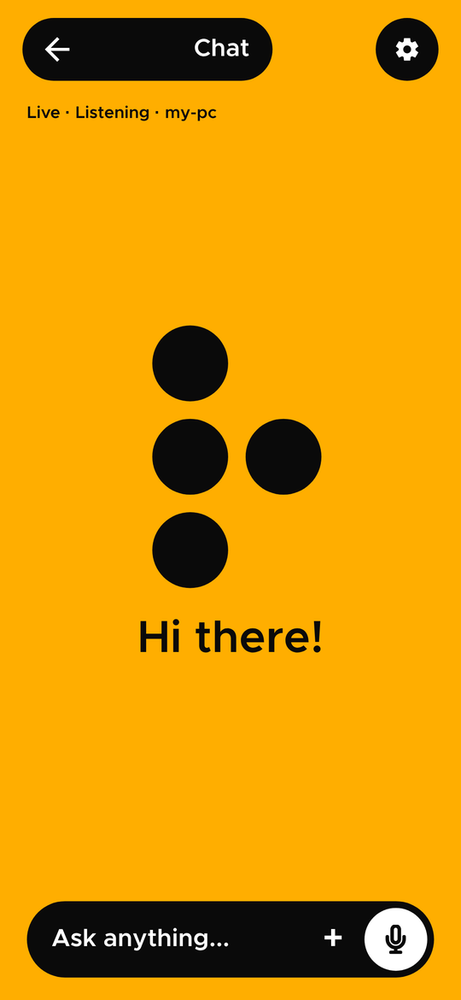<br><b>Chat</b><br><sub>Talk, or type in the pill</sub></td>
<td align="center">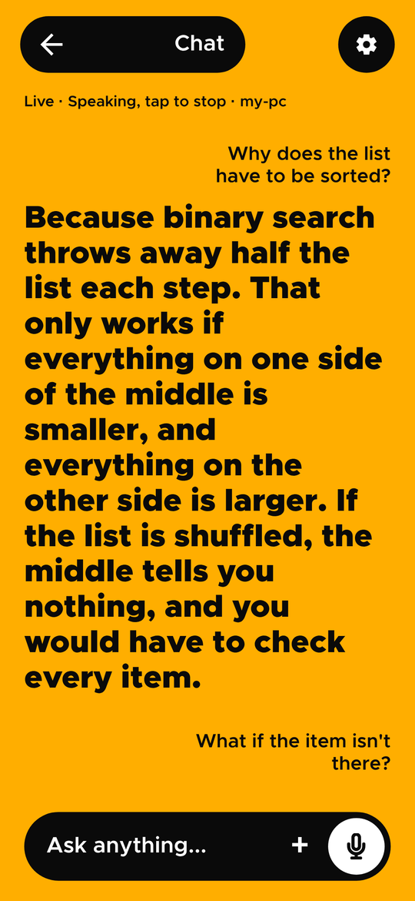<br><b>An answer</b><br><sub>Spoken while it is still written</sub></td>
</tr>
<tr>
<td align="center">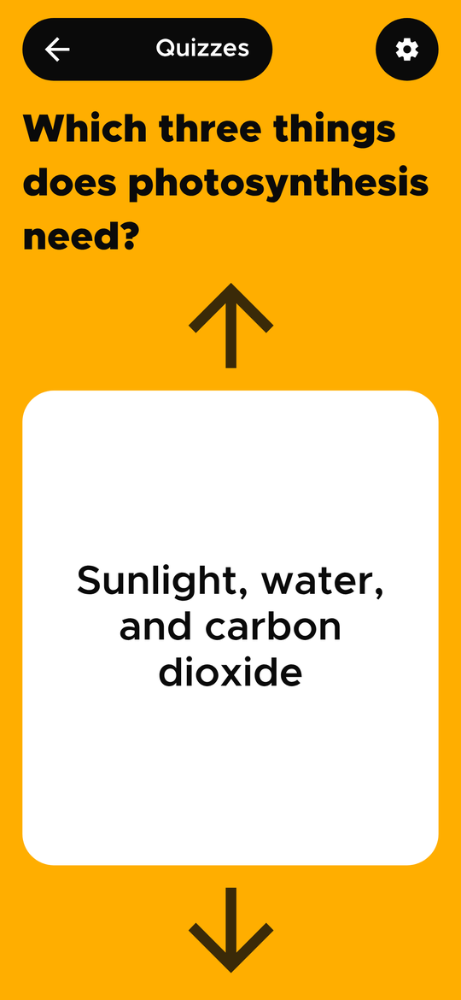<br><b>Quiz question</b><br><sub>Swipe to hear each option</sub></td>
<td align="center">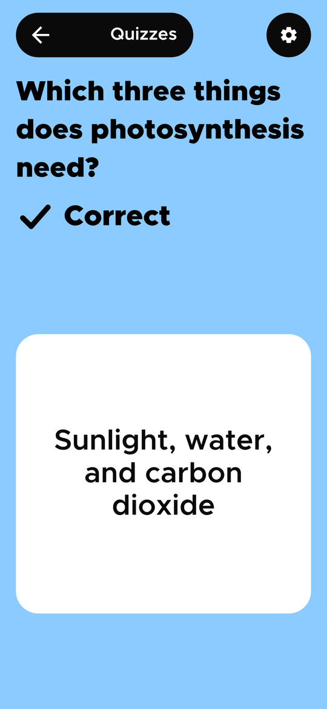<br><b>Correct</b><br><sub>Check mark, word, color, buzz</sub></td>
<td align="center">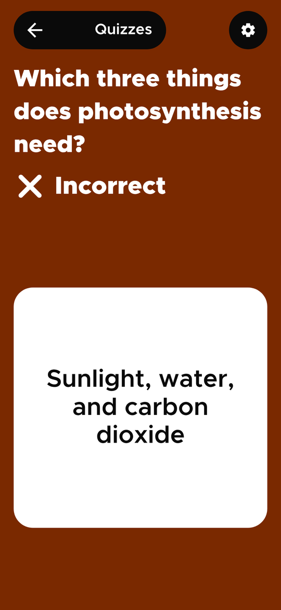<br><b>Incorrect</b><br><sub>Never red versus green alone</sub></td>
<td align="center">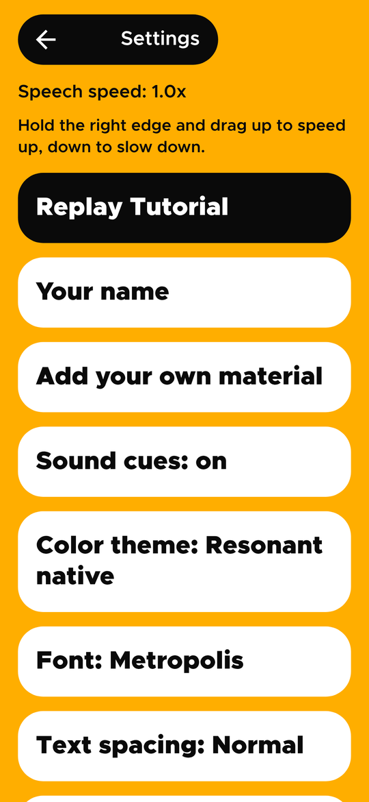<br><b>Settings</b><br><sub>Theme, font, spacing, voice, material</sub></td>
</tr>
</table>
</div>

### A note on the screenshots

The images in `docs/screens/` are rendered from the app's own layout code, using its real fonts, colors, shapes and sizes. They are not captures from a phone. To swap in real ones, run the app, take a screenshot of each screen (or `adb exec-out screencap -p > docs/screens/home.png`) and overwrite the file with the same name. Nothing else in this README needs to change.

<div align="center">
  
</div>

## What it is

A native Android (Kotlin + Jetpack Compose) prototype demonstrating a non-spatial interaction model: navigate lessons, listen to content, answer quizzes, and chat with an AI without ever needing to visually locate a button.

No auth, no database, no paid AI service, no API key. Lessons, Quiz and Settings are fully local, and so is your own material (kept as plain files in the app's storage). The built-in content is hardcoded. Chat and picture descriptions are the exceptions: they send what you say, your chosen material and the pictures you add to an Ollama server on your own network. Live voice also relays audio through LiveKit's free cloud tier between the phone and your PC (see "[Live mode](#live-mode-talk-to-your-pc)"). Nothing goes anywhere else.

**Your own material.** Add a text, Markdown or PDF file, or a photo or screenshot (Settings, from Chat, or Share to Resonant from any app). It is read like a lesson at the end of the Lessons list, and Chat answers from it.

| You add | What happens |
|---|---|
| Text or Markdown (up to 2 MB) | Split into sections and sentences, Markdown cleaned for the ear |
| PDF with real text (up to 30 MB) | The text is extracted; page numbers, running headers and split words are cleaned up. Pages with a chart or figure (a large embedded picture, or a caption such as "Figure 3") are also shown to the vision model, and its explanation is read right after that page's text, announced as "Figure on page 3." Up to 6 such pages |
| Scanned PDF | The first 30 pages are rendered and read on the phone (ML Kit, offline). Pages with a caption, or almost no words, are also explained like the figure pages above |
| Photo or screenshot (up to 20 MB) | The words are read on the phone (offline). A vision model on your Ollama server also describes it: for a graph, the type, axes, units, trend, highest and lowest values; for a table or diagram, its rows or its parts. Saved as "What the picture shows" and "Text in the picture" |

Reading a picture can take a minute, and a PDF with graphs a few, so the app says so first. If the server or the vision model can't be reached, only the words are kept (for a picture the app says so; for a PDF the graphs are simply left out). Setup is in "[Describing pictures](#describing-pictures)".

<div align="center">
  
</div>

## How it fits together

<div align="center">
  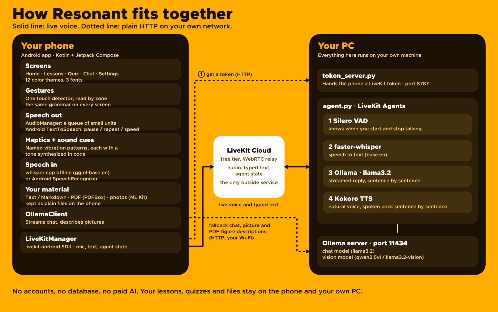
</div>

The phone does everything that must work offline: gestures, speech out, haptics and tones, offline speech recognition (whisper.cpp), reading your files (PDFBox, ML Kit) and the lessons and quizzes. Live voice is optional and runs on your own PC; the only outside service is the LiveKit relay in the middle. If the PC isn't there, Chat falls back to talking to Ollama directly, and if Ollama is down too, it reads from the lesson.

<div align="center">
  
</div>

## How to open and run it

1. Open this folder in Android Studio (Koala/2024.1 or newer; the project targets AGP 8.5.2 / Kotlin 1.9.24 / compileSdk 34).
2. The Gradle wrapper is committed, so `./gradlew` works from the command line and Android Studio uses it as is.
3. Copy `local.properties.example` to `local.properties` (Android Studio may already have created that file for `sdk.dir` — just add the Ollama and Live lines to it) and set them for your network. See the next two sections.
4. Sync, then run the `app` configuration on a device or emulator on API 26+.

On Linux (Arch / Omarchy) there is a one-time setup script and a `dev.sh`; see [docs/linux.md](docs/linux.md).

The app requests `VIBRATE` and `INTERNET` at install time (no runtime prompt), plus `RECORD_AUDIO`, asked for at runtime the first time you tap center on the Chat screen.

Unit tests are plain JVM tests — no device needed:

```bash
./gradlew :app:testDebugUnitTest      # or run them from Android Studio
```

<div align="center">
  
</div>

## Live mode: talk to your PC

Chat is always Live. You talk, a small agent on your own PC listens, thinks and answers in a natural voice, and the phone plays it back. You can also type in the pill at the bottom and the same agent answers.

```
voice: phone mic -> LiveKit -> agent/agent.py on your PC
typed: phone pill -> LiveKit (text packet) -> same agent turn
       Silero VAD -> faster-whisper -> Ollama (llama3.2) -> Kokoro TTS -> back to the phone
```

Everything except the LiveKit relay (free tier) runs on your PC: speech recognition, the language model and the voice.

1. **One-time setup.** Windows: install the Python requirements in `agent/` and put your LiveKit values in `agent/.env` (copy `agent/.env.example`). Linux: run `./scripts/setup-linux.sh`, see [docs/linux.md](docs/linux.md).
2. **Start the PC side.** `.\dev.ps1` on Windows, `./dev.sh` on Linux. It starts Ollama, the token server (port 8787) and the agent.
3. **Point the phone at it.** In `local.properties` set `live.tokenUrl` (your PC's LAN address, port 8787) and `live.tokenKey` (the same `TOKEN_KEY` as `agent/.env`). You can also change both on the phone: Settings, Debug Mode, swipe right, Server setup.
4. **Open Chat.** Resonant says "Live. Connected." and you can start talking. Tap the center to mute, or switch to hold to talk in Settings → Live mic.

What you can change in Settings: the agent's voice, its speaking speed, and whether the mic stays open or is hold-to-talk. Say "quiz me" (or "quiz me on photosynthesis") for a spoken quiz, or "open the lessons" to move around the app.

If the agent doesn't join within 12 seconds, typed questions go straight from the phone to Ollama and are spoken with the phone's own voice, so Chat keeps working. That path is the next section.

<div align="center">
  
</div>

## Chat / voice AI setup

This is the on-phone path: the fallback when the PC agent is not there. It needs only Ollama.

<div align="center">
  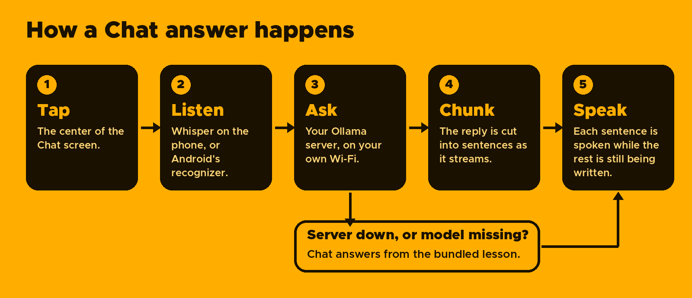
</div>

Tap the center of the Chat screen to talk. Your speech is transcribed on the device (offline with Whisper, or with Android's recognizer) and sent to your Ollama server; the reply is spoken sentence by sentence while the model is still writing the rest.

On a machine on your Wi-Fi, run `ollama pull llama3.2` (or any model you prefer), then start the server so the phone can reach it. By default Ollama listens only on the machine itself, so a phone can never connect unless you set `OLLAMA_HOST=0.0.0.0` first (PowerShell: `$env:OLLAMA_HOST="0.0.0.0"; ollama serve` — macOS/Linux: `OLLAMA_HOST=0.0.0.0 ollama serve`). If Windows Firewall asks, allow it on private networks.

In `local.properties` (git-ignored, so your LAN address is never committed):

```properties
ollama.baseUrl=http://192.168.1.50:11434
ollama.model=llama3.2
```

- `ollama.baseUrl` — that machine's LAN address. The default, `10.0.2.2`, only resolves from the Android emulator; a physical phone needs the real LAN IP. These are the defaults baked in at build time; you can override both on the phone without rebuilding (see "[Changing the server on the phone](#changing-the-server-on-the-phone)" below).
- `ollama.model` — must match a model you've already pulled.

Plain HTTP works in debug builds only (`src/debug/AndroidManifest.xml`). A release build needs an `https://` URL.

On Linux, if Ollama runs as a systemd service (the Arch package and the official installer both do this), put the setting in a drop-in rather than the unit file, so a package update can't overwrite it:

```bash
sudo systemctl edit ollama
```

```ini
[Service]
Environment="OLLAMA_HOST=0.0.0.0:11434"
```

Then `sudo systemctl restart ollama`.

Speech-to-text has two engines, chosen automatically by `VoiceInputController`:

- **Whisper (offline, on the phone)** — whisper.cpp with the `ggml-base.en` model, used once the model is downloaded. Download it from Settings → Offline voice model (a one-time download of about 150 MB, best on Wi-Fi). It works without internet and behaves the same on every device.
- **Android `SpeechRecognizer`** — the fallback until the model is downloaded (usually Google's; most recognizers need the device online), so voice works from the very first launch.

Text-to-speech goes through the same on-device `AudioManager` every other screen uses.

What Chat does so that silence never looks like a crash:

- "Listening." is spoken first, and the microphone opens only when it has finished — otherwise the recognizer can hear the app's own voice.
- While the model works, the phone pulses softly every couple of seconds and says "Still thinking. Tap the center to cancel." every ten. A tap cancels the request and closes the connection.
- Tapping while an answer is still being spoken starts a new question (barge-in) and stops the old stream.
- Every failure is announced out loud in one plain sentence — no HTTP bodies or socket errors, which are logged instead (`OllamaErrors.kt`).
- If the AI server can't be used (down, unreachable, or missing the model), Chat answers from the bundled lesson instead of only reporting the error — see "[When the AI server is down](#when-the-ai-server-is-down)" below.

### Describing pictures

Words in a picture are always read on the phone. To also have graphs, tables, diagrams and photos described, pull a model that can look at pictures and name it in `local.properties`:

```properties
ollama.visionModel=qwen2.5vl:3b
```

```bash
ollama pull qwen2.5vl:3b
```

The default is `llama3.2-vision`. `qwen2.5vl:3b` is a good small choice, reads charts well and answers in seconds; `gemma3:4b` is about the same size and often better on everyday photos. Like `ollama.model`, this is a build-time setting (no override on the phone), and it is optional: without it, pictures are still read for their words.

Things worth knowing:

- **Video memory.** A vision model's image reader needs a lot of memory on top of the model. On a GPU with about 4 GB it can fail with `cudaMalloc failed: out of memory`, and Ollama answers `500 ... unexpected EOF`. The fix is to run Ollama on the CPU (`Environment="CUDA_VISIBLE_DEVICES=-1"` in the same drop-in as above), or use a smaller model. On a CPU a picture takes from several seconds to a minute.
- **Test it without the app.** `ollama run qwen2.5vl:3b "Describe this chart. ./chart.png"` only attaches the picture if the path exists; look for the `Added image` line, or the model will describe a chart it never saw.
- **Small models make mistakes.** Expect the right title, axes and numbers on a clean chart, and missed details or wrong objects on busy photos.

### Changing the server on the phone

A different Wi-Fi means a different address, and rebuilding at a venue is not an option. From Home open Settings → Debug Mode, then swipe right in the middle of the screen to open Server setup: type the server's address (`192.168.1.50` is enough — the port defaults to 11434) and the model, tap Test connection to see whether the server is reachable and has the model (it tells you the `ollama pull` command if not), then Save. The change applies to the next Chat question and survives restarts. Use build defaults clears it. The Debug screen always shows the address in use.

### When the AI server is down

A dead server shouldn't end a demo. When Chat opens it checks the server (after the greeting, never over it):

- **Reachable, with the model** — the model is loaded into memory in the background, so the first question isn't the slow one (a cold load is often 10–30 s of silence).
- **Unreachable, or missing the model** — it says so once, and from then on answers from the built-in lesson instead: it picks the lesson section that best matches the question and reads it, saying "this is from the lesson". It is a keyword match, not understanding, and it admits when nothing fits ("I don't have a lesson on that. Try asking about Binary Search") rather than reading out something unrelated.

If the server dies mid-demo the same thing happens on the next question, and a server that has come back is noticed on the next question too (a 2-second look, not the full connect timeout). A server that drops part-way through an answer still gets the spoken "connection dropped" error, since something was already said. Add keywords to a lesson section (`LessonSection.keywords`) if people ask for it in words the text doesn't use.

<div align="center">
  
</div>

## The interaction model, in code

<details>
<summary><b>Show the full breakdown: files, speech queue, haptics, sound cues</b></summary>

<br>

| Concept | Where it lives |
|---|---|
| Gesture zones (`LEFT_EDGE` / `CENTER` / `RIGHT_EDGE`) + the pointer-input loop | `gestures/GestureManager.kt` |
| The pure decisions behind it (zone, swipe direction, hold step) — unit tested | `gestures/GestureClassifier.kt` |
| Gesture vocabulary | `gestures/InteractionZone.kt` |
| Centralized speech (semantic-unit queue, pause/resume/repeat/speed, streamed append, announcements with completion callbacks) | `audio/AudioManager.kt` |
| Centralized haptics (named pattern vocabulary, one place to retune) | `haptics/HapticPattern.kt`, `haptics/HapticManager.kt` |
| Sound cues (a tone per haptic pattern, synthesized in code, one place to retune) | `sound/SoundCues.kt`, `sound/SoundCueManager.kt` |
| Hardcoded lesson / quiz content, chat framing prompt | `content/LessonData.kt`, `content/QuizData.kt`, `content/ChatData.kt` |
| Voice input (one-shot speech-to-text): picks Whisper or the platform recognizer | `speech/VoiceInputController.kt`, `speech/WhisperSpeechInputManager.kt`, `speech/SpeechInputManager.kt`, `speech/whisper/` |
| Streamed reply → speakable sentences | `speech/SentenceChunker.kt` |
| Ollama streaming client, picture description call + build-time config | `network/OllamaClient.kt`, `network/OllamaConfig.kt` |
| Your own material: the store, parsing into lessons, the three ways in, putting it in front of the model | `content/MaterialStore.kt`, `content/MaterialParser.kt`, `content/MaterialImporter.kt`, `content/MaterialContext.kt`, `content/LessonLibrary.kt` |
| PDFs and pictures: text extraction and cleanup, on-device text recognition, page rendering, which PDF pages have a figure, how descriptions and words become material | `content/PdfTextExtractor.kt`, `content/PdfTextCleaner.kt`, `content/PdfFigures.kt`, `content/ImageTextReader.kt`, `content/ImageMaterial.kt` |
| Shared gesture surface, debug wiring, TalkBack actions | `ui/components/GestureSurface.kt` |
| The screens | `ui/home`, `ui/lessons`, `ui/quiz`, `ui/chat`, `ui/settings`, `ui/onboarding`, `ui/talkback` |
| Debug/developer mode | `ui/settings/DebugScreen.kt` (Settings → Debug Mode) |

Every screen attaches the same `GestureSurface`. That's what keeps the gesture grammar identical everywhere — no screen invents its own touch handling. `GestureManager.kt` is the only file that reads raw pointer input; it classifies touches into `ResonantGestures` using relative zone boundaries, so nothing depends on fixed screen coordinates.

Holds are decided by a real timeout, not by waiting for the next pointer event (a perfectly still finger produces almost none), so the "hold engaged" haptic fires at the 500 ms mark, not on release.

`AudioManager` treats all spoken content — lesson sections, quiz prompts and options, chat replies — as a queue of small `SemanticUnit`s with a current index. Lessons and chat auto-advance through their queue; quiz screens use the same `next()`/`previous()` to explore answer options. Chat replies arrive while the queue is being read, so units can be appended and playback continues across the gap.

`HapticManager` is the only class that touches the system `Vibrator`. Every pattern is a named `HapticPattern` with its timing in one map (`HapticPatterns.timings`). Quiz options A–D are a separate, counted family of long pulses (1–4) that shares nothing with the navigation patterns — a unit test enforces it.

**Sound cues.** Every haptic pattern also has a short tone (`SoundCues.specs`), played by `SoundCueManager` because `HapticManager.play` calls it — so no screen knows sound exists, and a screen that buzzes also sounds. Several patterns buzz almost alike (a 50 ms pulse is both "next" and "confirm"); their tones do not: direction is pitch contour (rising = forward / faster / correct, falling = back / slower / wrong), quiz options are 1–4 beeps, and the repeating Chat "thinking" tick is much quieter than the rest. Tones are generated in code (no audio files), kept above 300 Hz because phone speakers can't reproduce lower notes, and follow the media volume like speech does. They are silent while the app is off-screen. Toggle them in Settings → Sound cues (on by default, remembered). With headphones connected (wired, USB or Bluetooth, and Android's Mono audio off) every cue also sits a little to one side, so it is not heard as part of the voice: back, slower and wrong on the left, everything else on the right, the far ear at 65% rather than silent so a single earbud still hears them all. Speech is never moved. On the phone speaker nothing is panned. The sides and the 0.35 offset are in `sound/CuePan.kt`; headphone detection is `sound/HeadphoneDetector.kt`. A unit test checks that no two patterns share a cue, so the set can't drift back to duplicates.

**Font and text spacing.** Settings → Font cycles Metropolis (the default), Atkinson Hyperlegible and Lexend, and Settings → Text spacing cycles Normal, Roomy and Extra roomy. Both are remembered. The font is `ActiveFont` in `ui/theme/Fonts.kt`: `MetropolisBlack` is now a live getter, so every `fontFamily = MetropolisBlack` already means "the chosen font", and the shared text styles are getters too so they follow it. The RESONANT wordmark stays in `BrandFamily` (Metropolis). Spacing is `ActiveSpacing` in `ui/theme/TextSpacing.kt` (letter spacing plus a taller line height) and applies to lesson text and the quiz question. Atkinson Hyperlegible Next and Lexend are under the SIL Open Font License; the license texts are in `docs/fonts/`.

**Color themes.** Settings → Color theme cycles twelve themes, the first seven taken from the design mockups: Resonant native (the orange default), Low vision enormous contrast, Cataracts high clarity, Monochrome colorblind, Handsfree screen reader, Photophobia and Warm ambiance, then five more: Night red, Blue on yellow, Soft cream, Paper gray and White on blue. The choice is remembered. A theme is a `ThemePalette` (`ui/theme/ThemePalette.kt`): screen, card, text, text on a focused row, dim menu text, top bar and what is on it, button and what is on it, and optional outlines (Cataracts outlines cards in yellow; Handsfree outlines everything in white). `BrandOrange`, `BrandInk`, `ResonantCard`, `ResonantOnInk`, `ResonantDim`, `ResonantBar`, `ResonantOnBar`, `ResonantButton` and `ResonantOnButton` read the active theme, and `Modifier.cardBorder` / `Modifier.controlBorder` draw the outlines, so a screen takes the new look without knowing themes exist. `ThemePaletteTest` checks every text pairing is at least 7:1. After a quiz answer the screen takes the theme's own correct and incorrect colors (blue-ish against brown-ish, or light against dark, depending on the theme). Those two fills always differ a lot in brightness, and the result screen also shows a check or a cross and the words Correct or Incorrect, so it never depends on telling red from green. `ThemePaletteTest` checks the text on both and that the two fills are at least 2:1 apart.

**Motion.** Settings → Reduce motion (tap toggles it; Resonant says "Reduce motion: on" and plays a confirm tick) turns animation off, and so does Android's own "Remove animations". Both feed one answer, `ActiveMotion` in `ui/theme/Motion.kt`, and every animation takes its length from `ActiveMotion.ms(base)`, which is 0 when motion is reduced, so no screen reads the system animation scale itself. Motion is never the only signal (the haptic, tone or speech is always there) and nothing loops, bounces or idles. Screens fade into each other over 250 ms with no sliding (`ui/nav/Navigation.kt`). The focused row's colors fade over 250 ms (`focusColor()` in `ui/components/FocusFade.kt`). A pressed card or button shrinks to 97% for 120 ms (`pressScale` in `ui/components/Press.kt`; not on Home or Settings rows, which carry hold and focus logic, nor on the chat circles). Quiz result colors fade in over 250 ms, the "Voice is unavailable" banner fades over 250 ms, and the score bar fills once on arrival. The splash runs about 2.9 s of animation plus a 1.5 s hold on the finished mark (`ui/splash/SplashMotion.kt`: the dots gather, orbit and land in the R, then rings ripple out and RESONANT rises in), or shows the finished mark still for 1.5 s with Reduce motion. One exception: scrolling the focused item into view still glides.

**Shape, outline and touch size.** Each `ThemePalette` also sets `cardRadius` and `controlRadius` (28 dp cards and pill buttons by default) next to its outlines, so themes differ in shape as well as color: Low vision 12 / 14 dp with a yellow outline, Cataracts 20 / 20, Monochrome 4 / 4 with a black outline, Handsfree 8 / 8, Photophobia 36 dp cards with pill buttons, Warm 24 dp cards with pill buttons. Cards use `cardShape()` and `cardBorder(...)`, buttons and bars use `controlShape()` and `controlBorder(...)` (`ui/theme/ThemeBorders.kt`), so no screen hard-codes a radius. Every theme except the default keeps its card, bar and button edges visible, with an outline or at least 3:1 against the screen, and `ThemePaletteTest` checks it; the default orange theme is exempt on purpose, because white cards on orange are the Figma brand look. Anything you tap is at least `MinTouchTarget` (56 dp, `ui/theme/Dimens.kt`).

**Focus.** On the Lessons list, Quiz list and Lesson mode the focused card is drawn inverted (ink fill, the theme's text-on-focus color, the button flipped), and those lists and Settings scroll the focused item into view, so focus is never only spoken or sitting off screen.

</details>

<div align="center">
  
</div>

## Visual design

<details>
<summary><b>Show the full breakdown: gradient, contrast, type scale, spacing</b></summary>

<br>

The visual layer is a secondary concern to speech/haptics for the actual target user, but it matters for low-vision users, sighted family members helping set up the app, and anyone using system dark mode — so it gets the same rigor as everything else.

**Flat, harsh gradient — no grain, no blur.** `ResonantSurface.kt` renders a two/three-stop `Brush.verticalGradient` (yellow → orange in light mode, near-black → burnt orange in dark mode) instead of a baked image asset. Every screen shares it, read from `LocalResonantColors` so it switches with system dark mode automatically — screens never branch on `isSystemInDarkTheme()` themselves.

**No text color ever depends on where it sits on the gradient.** The previous design swapped text to white in some spots and used alpha-faded black for "unfocused" items; both measured as low as ~1.3:1 and ~2:1 against this background — a real WCAG failure, not just a style note. The fix:

- All body text is one solid, full-opacity color per theme (`ResonantTextOnLight` / `ResonantTextOnDark`), never alpha-blended. Focused-vs-unfocused hierarchy comes entirely from size and weight now.
- The "current item" indicator (menu, lessons, settings) is a solid filled chip behind the text, not a color swap — `ResonantFocusedFillLight/Dark` with `ResonantFocusedTextLight/Dark`, always ~19.8:1 regardless of gradient position.
- Quiz correct/incorrect feedback is the same solid-chip pattern, not colored text directly on the gradient (plain green/red text there measured under 2.5:1). Light and dark theme use different chip colors, since a fill that reads against the light gradient nearly vanishes against the dark one.

Every color pairing the app actually uses is contrast-checked against WCAG 2.1 in `ui/theme/Color.kt`'s comments, and enforced by `ContrastTest.kt` so a future edit can't silently reintroduce a low-contrast pairing.

**Type scale is tuned for low vision, not just visual weight** (`ui/theme/Type.kt`): body text starts at 26sp/22sp rather than 18sp/16sp, line heights are ~1.3–1.55× font size (generous leading, since tight leading is hard to track for anyone with field loss), and there is no small "caption" role — the smallest text on screen is still 20sp. All sizes are in `sp`, so the system font-scale setting still stacks on top of this baseline.

**Spacing is symmetric.** `ui/theme/Dimens.kt` defines one horizontal margin (`ScreenHorizontalPadding`, 40.dp) used on both edges of every screen — the previous per-screen values (32.dp/24.dp, or 52.dp/24.dp on Home) were left over from a background image with visual weight on one side; the flat gradient has none, so there's no reason for margins to be lopsided anymore. The left/right gesture zones (`EdgeZoneWidth`, also in `Dimens.kt`) were bumped from 48.dp to 64.dp at the same time, and the visual margin now matches the actual touch target.

</details>

<div align="center">
  
</div>

## The gesture grammar

<div align="center">
  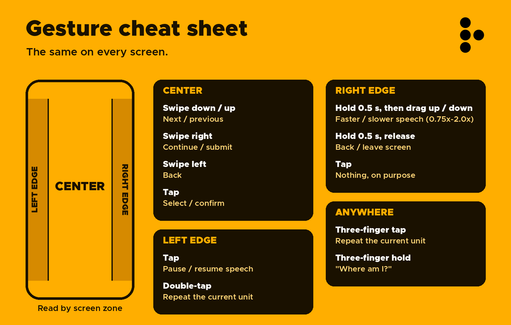
</div>

Almost the same on every screen (the two swipe rows below differ by screen, as noted):

| Where | Gesture | Does |
|---|---|---|
| Center | Swipe down / up (one finger) | Next / previous: quiz option, chat sentence, lesson-mode choice |
| Center | Swipe down / up (two fingers) | Next / previous on menus and scrolling lists: Home, Lessons, a lesson's units, Quiz list, Settings. One finger scrolls those lists instead |
| Center | Tap an item | Home: opens that item directly. Tapping empty space still opens the focused one |
| Center | Swipe right | Continue / submit (Lesson: next section; Quiz: submit) |
| Center | Swipe left | Back (Lesson: previous section) |
| Center | Tap | Select / confirm (Chat: ask a question, or cancel while thinking) |
| Left edge | Tap | Pause / resume speech. Resuming carries on from the exact spot you paused at (the same goes after leaving the app and coming back); a double-tap starts the unit again from the top |
| Left edge | Double-tap | Repeat the current unit |
| Right edge | Hold ~½ s (three quick ticks), then drag up / down | Speech faster / slower, in six steps (0.75×–2.0×); remembered between launches |
| Right edge | Hold ~½ s, release without dragging | Back / leave screen |
| Right edge | Tap | Nothing, deliberately (no accidental triggers) |
| Settings | Hold the middle on Color theme, Font or Text spacing, then swipe left / right | Preview: the screen shows each option as you swipe and Resonant says its name and place ("Warm, 7 of 12"), with a tick per step and an edge bump at the ends. Tap keeps it, hold the right edge (or the on-screen Back) cancels and puts the old one back. Tapping the row still cycles as before |
| Any screen | Pinch with two fingers | Text size for the whole app, 75% to 250%. A tick plays at each quarter step and an edge bump at the limits; the size is saved and said once the fingers rest. Three-finger hold in a lesson says the current size. Not in the tutorial or setup (setup has its own text-size step). Home, Lesson mode and the quiz score stop growing at 120%, 130% and 100% so their large words still fit |
| Anywhere | Four fingers dragged left | Rewind, 5 s per step with a tick for each, applied when you lift. With TalkBack: the "Rewind 10 seconds" action |
| Anywhere | Three-finger tap | Repeat the current unit |
| Anywhere | Three-finger hold | "Where am I?" — screen, position, playback state |

In the tutorial, a hold on the left edge skips the lessons. After the ten lessons (they include four-finger rewind and pinch; those two are only listened for while their own lesson, or the practice area, is open) or after skipping them, comes the practice area: try any gesture, pinch and four-finger rewind included, and Resonant says what you just did and what it means ("You just swiped down with two fingers, which means next"), with the real haptic and tone, and nothing is acted on. Swipe right twice to start, or hold the left edge to leave at once. Every first launch goes through it, and Settings → Replay Tutorial opens it again. The wording lives in `gestures/GestureExplainer.kt`.

**Spoken hints.** If you go quiet, the screen says one short hint, for example "Swipe down for the next option, tap the middle to choose, or hold three fingers to hear where you are." It speaks after 25 s of nothing from you and nothing from the app, or when three gestures in a row did nothing, in which case it starts with "Having trouble?". It never speaks while the app is talking, while speech is paused, in the background, in Chat (live microphone) or in the tutorial. At most three per visit to a screen, 45 s apart. A gesture counts as "did nothing" when its handler played no haptic cue, or only an error or end-of-list one. The rules are in `gestures/HintEngine.kt`; a screen sets its own sentence with `GestureSurface(hint = ...)`, and Lesson and Quiz do.

Try the full walkthrough without looking: open the app, start the lesson, pause, resume, repeat a unit, change speed, move between sections, jump into the quiz, explore every option by sound and touch alone (each option has its own counted buzz), select one, submit it, hear whether you were right, and get back to another section.

The Debug screen (Settings → Debug Mode) mirrors live state — screen, semantic unit, selected option, speech state/speed, last gesture and haptic — the fastest way to check the gesture classifier while testing blind.

<div align="center">
  
</div>

## TalkBack

Resonant's gestures are raw touches read by its own detector. With TalkBack on, TalkBack owns the touch stream and Resonant's swipes/taps/holds never arrive, so the app detects it at launch (and live, if toggled from Quick Settings) and shows a notice with two ways forward:

1. Turn TalkBack off and use the gestures above.
2. Keep TalkBack on and use its Actions menu on any Resonant screen. `GestureSurface` exposes the grammar as custom actions — Next, Previous, Select, Continue, Back, Leave screen, Pause or resume, Repeat, Where am I, Faster speech, Slower speech (and Larger text, Smaller text on the lesson screen). Each one is dispatched through the same handler as the real gesture, so every screen supports it with no extra code.

Known limits of path 2: Resonant's own voice and TalkBack's voice can overlap, and it has not yet been tested against real TalkBack users. Whether a direct-touch / pass-through mechanism could let the raw gestures coexist with TalkBack is still an open investigation.

<div align="center">
  
</div>

## Themes

Settings → Color theme cycles twelve themes. They are not just color swaps: each one also sets its own corner radius, outline and edge contrast, so they feel like different places. Hold the middle on the Color theme row and swipe left or right to preview each one before you keep it.

<div align="center">
  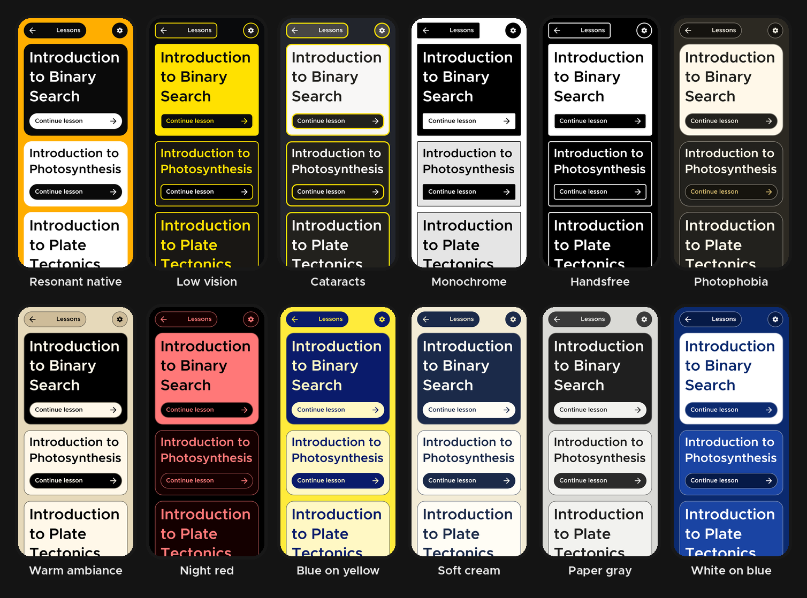
</div>

<br>

After a quiz answer the screen takes the theme's own correct and incorrect colors, and always shows a check or a cross and the words Correct or Incorrect, so the result never depends on telling colors apart.

<div align="center">
  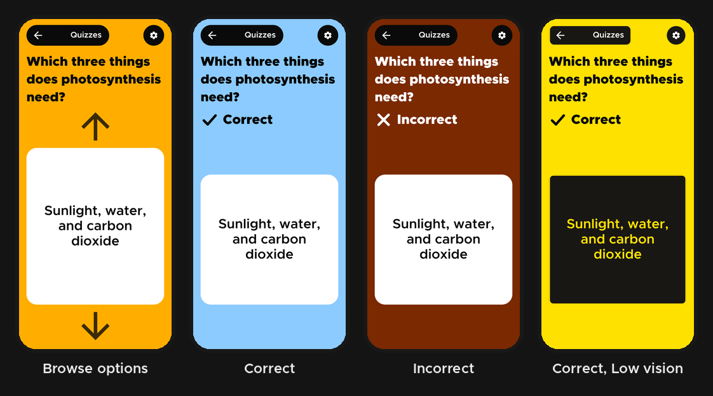
</div>

<br>

Contrast of every text pairing is at least 7:1 in every theme, checked by `ThemePaletteTest`. The default orange theme is exempt from the edge-contrast check on purpose, because white cards on orange are the brand look.

<div align="center">
  
</div>

## Project layout

| Path | What is in it |
|---|---|
| `app/` | The Android app (Kotlin, Jetpack Compose), including the whisper.cpp offline speech engine |
| `agent/` | The PC agent for Live mode: `agent.py`, `token_server.py`, voice commands and the spoken quiz |
| `docs/` | Images used in this README, [dots.md](docs/dots.md) (the animated R), [linux.md](docs/linux.md), a sample material file |
| `scripts/setup-linux.sh`, `dev.sh`, `dev.ps1` | One-time Linux setup and the one-command dev start |
| `ROADMAP.md` | Working notes and the checklist of what is done and what is not |

<div align="center">
  
</div>

## Known prototype limitations

- Six built-in lessons and four quiz sets are included (`content/*.kt` is where you'd add more); anything else is your own material.
- Chat keeps the last 20 exchanges (`ChatHistoryStore`), saved on the phone, and resends them each turn.
- Only the first 6,000 characters of your chosen material are given to the AI model (`MaterialContext`), cut at a whole sentence.
- A PDF is read for graphs on at most 6 pages, chosen by a large embedded picture or a "Figure N" style caption (or, for a scan, a caption or almost no words), so an uncaptioned vector chart in a text PDF can be missed. The whole page is described, not just the figure. A scanned PDF is read for its first 30 pages only.
- Picture descriptions come from a small model on your own server, so they can be wrong, and they are slow on a machine without a usable GPU.
- The right-edge "contextual action" is intentionally minimal per the spec.
- TextToSpeech quality and voice depend entirely on the engine installed on the test device.

<div align="center">
  
</div>

## License

Copyright (c) 2026 Aleks Lime. **All rights reserved.**

The source is public so you can read it and see how Resonant works, but it is **not open source**. You may not use, copy, modify, build, redistribute or train models on it without written permission. Third-party components keep their own licenses (see Credits). The full terms are in [LICENSE](LICENSE).

## Contributing

Feedback is very welcome, especially from blind and low-vision users, and bug reports with your phone model, Android version and whether TalkBack was on. Code contributions are not accepted by default because of the license above; please open an issue first. Details are in [CONTRIBUTING.md](CONTRIBUTING.md).

## Credits

Resonant stands on a lot of generous work. Each of these keeps its own license; check each project for the exact terms of the version you use.

| What | Used for | By | License |
|---|---|---|---|
| [whisper.cpp](https://github.com/ggml-org/whisper.cpp) and the Whisper `ggml-base.en` model | Offline speech recognition on the phone | ggml-org, OpenAI | MIT |
| [faster-whisper](https://github.com/SYSTRAN/faster-whisper) | Speech recognition in the PC agent | SYSTRAN | MIT |
| [Silero VAD](https://github.com/snakers4/silero-vad) | Detecting when you start and stop talking | Silero | MIT |
| [Kokoro](https://github.com/hexgrad/kokoro) and [kokoro-onnx](https://github.com/thewh1teagle/kokoro-onnx) | The natural PC voice | hexgrad, thewh1teagle | Apache-2.0 (model), MIT (kokoro-onnx) |
| [Ollama](https://ollama.com) | Running the language and vision models locally | Ollama | MIT |
| llama3.2, qwen2.5vl, llama3.2-vision, gemma3 | Chat and picture descriptions | Meta, Alibaba Cloud, Google | Each model has its own license |
| [LiveKit](https://livekit.io), `livekit-android`, LiveKit Agents | Live voice between phone and PC | LiveKit | Apache-2.0 |
| [PdfBox-Android](https://github.com/TomRoush/PdfBox-Android) | Reading text from PDFs | Tom Roush, Apache PDFBox | Apache-2.0 |
| [ML Kit text recognition](https://developers.google.com/ml-kit) | Reading words in photos and scanned pages, offline | Google | ML Kit terms |
| Jetpack Compose, AndroidX, Kotlin, kotlinx.coroutines | The app itself | Google, JetBrains | Apache-2.0 |
| [Atkinson Hyperlegible Next](https://www.brailleinstitute.org/freefont/) | An optional typeface made for low vision | Braille Institute | SIL OFL 1.1 (see `docs/fonts/`) |
| [Lexend](https://www.lexend.com) | An optional typeface designed for easier reading | Lexend Project | SIL OFL 1.1 (see `docs/fonts/`) |
| Metropolis | The default typeface and the wordmark | Chris Simpson | SIL OFL 1.1 |

Design started from a Figma mockup; the braille "R" mark and the Resonant  belong to the project owner (see [LICENSE](LICENSE)).
